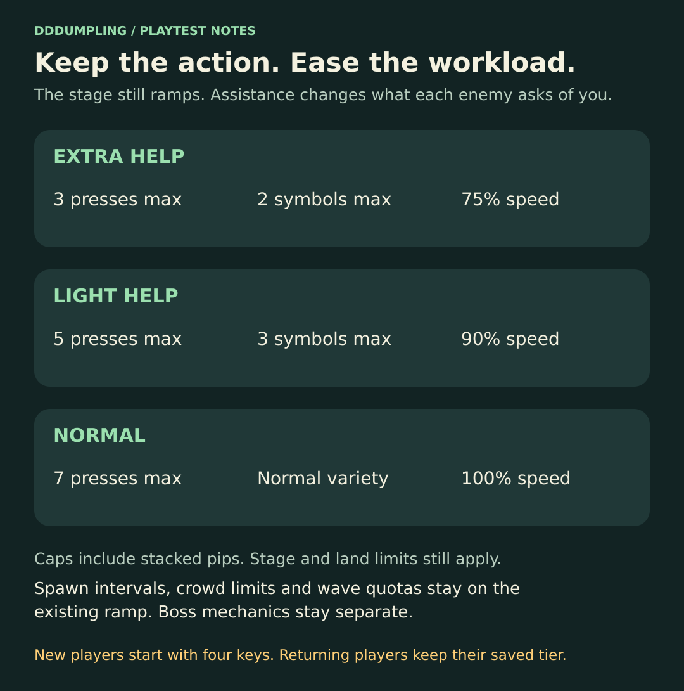
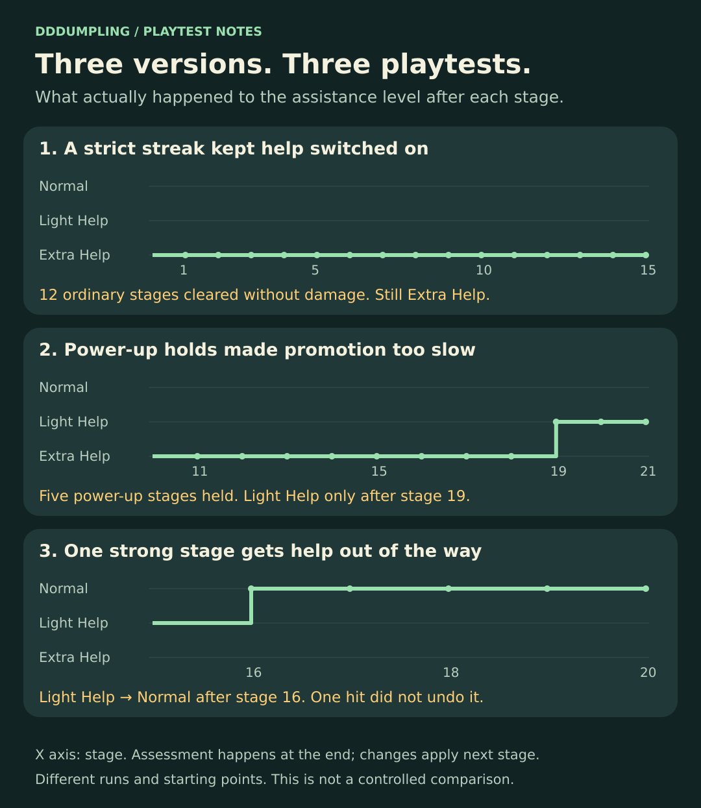
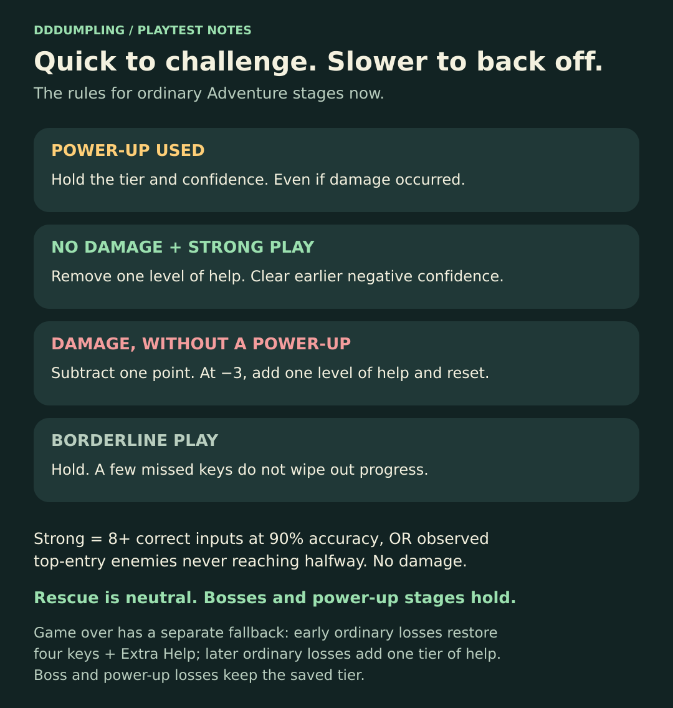

# Let more players meet the bosses

*DDDUMPLING dev blog · November 1, 2026 · Development update*

[Read on itch.io](https://theorifice.itch.io/dddumpling/devlog/1745553/let-more-players-meet-the-bosses)

I did some playtesting with kids and the difficulty ramp was too much. Especially the word length. There is a lot going on when you are still learning which squishy goes with which key, and adding more keys and longer words makes that pile up quickly.

I want players to be challenged, but I also want them to get to the bosses. That's the big payoff. The bosses have different mechanics, personalities and a bunch of animation work that I want people to actually see. Getting stuck in the ordinary stages before reaching them is a problem.

So we started working on dynamic difficulty for Adventure. The existing ramp is still the ceiling. The game can give you help underneath that, then take the help away as you get comfortable.

I didn't want to reduce spawn pressure. Clearing enemies should still feel busy and fun. The knobs are how many presses each enemy needs, how many different symbols it uses, and how quickly it moves.

The first version was too cautious. It needed three strong stages in a row to remove one level of help. A few misses could reset that progress. Ninja was a problem too: you could clear a ton of enemies but barely press a key, so the game didn't think you had demonstrated anything.

I added local playthrough logs so we could see what was actually happening. In one run, I cleared twelve ordinary stages without taking damage or using rescue. The game still kept me at maximum assistance. It felt easy because it was keeping everything easy.

One useful observation: if enemies never get halfway down the screen, I'm probably doing pretty well. Accuracy by itself misses that. We now look at field control too, excluding side-entry enemies because they can start lower down.

I also don't want rescue use to count as trouble. It's there to be used. Damage counts. Power-up stages should just hold, since they change how you play. Bosses should be separate too. Losing a boss doesn't necessarily mean the ordinary enemies were too hard.

That fixed some things, but the next run still felt too easy. Five of the eight ordinary stages used a power-up. Holding those stages meant it took until stage 19 to get out of Extra Help.

So let's make it asymmetric. One strong ordinary stage removes one level of help. It takes three damaged stages to add help back, with a strong stage clearing that negative confidence. A borderline stage holds. One mistake shouldn't send everything backwards.

There is still a quicker fallback for a game over in an ordinary stage. An early loss can return the player to four keys and Extra Help. A later loss adds one level of help for the next run. Power-up and boss losses keep the saved assistance.

The latest run did what I expected. I started on Light Help, reached Normal after the first eligible stage, and the later waves put more pressure on me. Taking one hit didn't immediately reduce the difficulty again.

These charts are from my follow-up runs, not a claim that we have finished testing with kids. They're different runs with different starting points. The logs are local developer recordings that I exported manually; nothing is being automatically uploaded from players.

This feels much closer. I want the game to notice when someone is doing well and challenge them. I also want a less experienced player to have enough room to learn, make progress, and get to that big squishy boss waiting at the end of the land.
